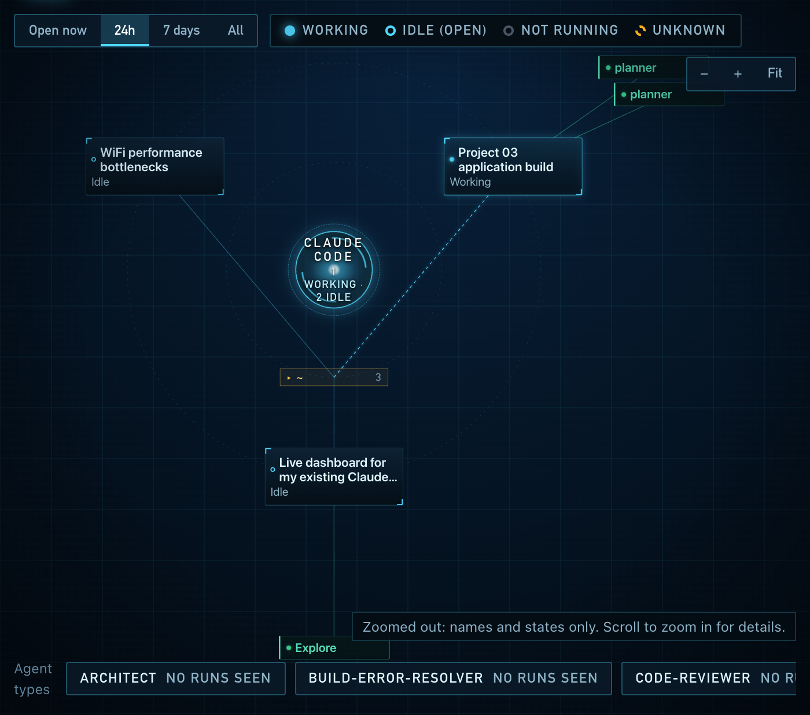

# Agent Dashboard

A read-only, real-time dashboard for my Claude Code agents, sessions and subagents. It watches; it never starts, steers, stops or reconfigures anything, and never writes to `~/.claude`.



*The overview map, zoomed out, with real sessions from one Mac (names and states only; zoom in for detail).*

## Start

Requires Node 18 or newer (developed on Node 24). No dependencies and no build step.

```bash
git clone https://github.com/pomegranate692-creator/agent-dashboard.git
cd agent-dashboard
npm start          # same as: node server/index.js
```

Then open <http://localhost:4317>. Options: `--port <n>` to change the port, `--root <dir>` to read a different Claude folder (default `~/.claude`). It listens on `127.0.0.1` only. Tests: `npm test`.

## What it can observe

| Source | Used for |
|---|---|
| `~/.claude/sessions/<pid>.json` (the live-session registry) | which sessions have a running process, and whether each is busy or idle |
| `~/.claude/projects/*/<sessionId>.jsonl` | prompts, replies, tool calls and results, errors |
| `~/.claude/projects/*/<sessionId>/subagents/` | subagent runs, linked to the parent call that started them |
| `<task-notification>` records in the parent transcript | completion of background subagents |
| `~/.claude/agents`, project and plugin agent folders | configured agent definitions, shown separately from running instances |

The UI has a **map** (hub → projects → sessions → subagents), a **flow** view for one session with replay, a side **inspector** for full prompts, output and errors, and a **recent activity** feed. Configured agents, running instances and past activity are kept visibly apart.

Nothing is guessed. A tool call with no result reads as Running only while its session is registered as working. A background subagent reads as Running only while its own transcript was written in the last 45 seconds, and its end time is the completion report, never the launch. If the browser loses the server, everything is marked unknown rather than assumed finished.

## What it can't observe

- Pending permission prompts: they are not written to any file. Only questions Claude asked you (`AskUserQuestion`, `ExitPlanMode`) show as waiting for you.
- Sessions that don't write to `~/.claude`, such as cloud sessions and other machines.
- Agents passed with `--agents` on the command line, unless a session listed them.
- Private reasoning, which is never read or shown. API keys and tokens are masked in previews.
- Costs: dollar costs aren't in transcripts and aren't estimated. Token counts for subagents are only what Claude Code itself reported.
- Anything instantly: transcripts are written slightly after events, so expect a 1–2 second lag.

## Try it without real data

```bash
node scripts/simulate-live.js /tmp/ad-fixture &
node server/index.js --root /tmp/ad-fixture --port 4318   # shows a FIXTURE DATA banner
```

## License

[MIT](LICENSE) © 2026 Romaan Malik
